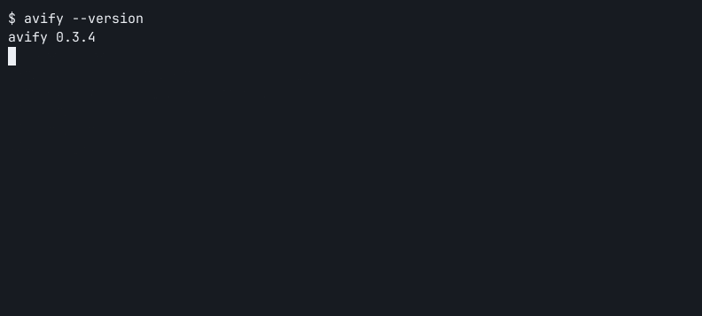

# avify

Batch-convert photo folders to smaller AVIF files with parallel encoding in Rust.

[](LICENSE)
[](https://github.com/mrgnw/avify/commits/main/)
[](https://github.com/mrgnw/avify/issues)
[](https://github.com/mrgnw/avify/releases/latest)
[](Cargo.toml)
[](#install)



[Install](#install) · [Usage](#usage) · [Size savings](#size-savings) · [Roadmap](ROADMAP.md) · [Contributing](CONTRIBUTING.md)

> [!NOTE]
> This project uses AI-assisted development and documentation. Contributions are welcome; changes need review and local checks. avify is pre-1.0, so behavior and flags may change.

## Who it is for

Photographers and people with folders of photos, screenshots, or screen recordings who want smaller sharing copies without opening an editor. Give avify files or a folder; it prints per-file savings and a final summary.

> [!WARNING]
> By default, each original is moved to the trash after a smaller output is written. Use `--keep` to retain originals. The examples below keep them unless they explicitly move them to an archive folder.

## Features and limits

- **Parallel still-image encoding** across CPU cores, powered by [ravif](https://github.com/kornelski/cavif-rs) and [rayon](https://github.com/rayon-rs/rayon).
- **Camera RAW and common image formats:** ARW, CR2, CR3, DNG, NEF, ORF, RAF, RW2, PEF, SRW, X3F; JPEG, PNG, WebP, BMP, TIFF, TGA, GIF, JPEG XL, and flattened PSD.
- **HEIC/HEIF:** system `sips` on macOS, or an optional build using libheif.
- **Smaller outputs only:** if conversion is not smaller, avify discards the output and keeps the original. A keep marker lets subsequent runs skip that file.
- **Optional AV1 video:** `--video` enables common video formats. Animated GIFs become AV1 video automatically, preserving animation; ffmpeg is required for either route.
- **Experimental XMP edits, RAW only:** approximations of Lightroom exposure, contrast, highlights, shadows, white balance, crop, saturation, and vibrance. Other edits are ignored; see [#8](https://github.com/mrgnw/avify/issues/8).
- **8-bit decoding, 10-bit AVIF encoding:** source HDR and higher-bit-depth detail are not preserved.
- **Metadata is dropped:** EXIF, ICC color profiles, and orientation tags are not copied. Color and orientation can differ; see [#3](https://github.com/mrgnw/avify/issues/3). Keep archival originals.

Folders are scanned one level deep. Recursive scanning, collision protection, and shell completions are planned in the [roadmap](ROADMAP.md). Use distinct input stems and a fresh output folder: inputs such as `scene.jpg` and `scene.png` both write `scene.avif`, and existing outputs can be overwritten.

## Install

Source builds require **Rust 1.88 or newer**. On x86_64 Linux, the AV1 encoder also needs `nasm`.

| Platform | Available route | Status |
|-|-|-|
| macOS, Apple silicon | [Prebuilt v0.2.1 archive](https://github.com/mrgnw/avify/releases/download/v0.2.1/avify-v0.2.1-aarch64-apple-darwin.tar.gz), or Cargo from Git | Native HEIC via `sips` |
| macOS, Intel | Cargo from Git | No prebuilt release asset |
| Linux | Cargo from Git | HEIC needs the optional libheif build; trash and keep-marker parity remain [open](https://github.com/mrgnw/avify/issues/9) |
| Windows | No verified installation route | Support is [in progress](https://github.com/mrgnw/avify/issues/9) |

The latest GitHub release is **v0.2.1**. This README and demo describe **v0.3.4 from Git**, which has newer flags and behavior. Use the source route for the features shown here.

### Current source, macOS and Linux

```sh
cargo install --git https://github.com/mrgnw/avify.git --locked
```

Check the installed binary:

```sh
avify --version
```

### Prebuilt macOS release, Apple silicon

Download into an empty temporary directory:

```sh
INSTALL_DIR=$(mktemp -d)
```

```sh
curl -fL https://github.com/mrgnw/avify/releases/download/v0.2.1/avify-v0.2.1-aarch64-apple-darwin.tar.gz -o "$INSTALL_DIR/avify.tar.gz"
```

```sh
tar -xzf "$INSTALL_DIR/avify.tar.gz" -C "$INSTALL_DIR"
```

Install into a directory on your PATH:

```sh
mkdir -p "$HOME/.local/bin"
```

```sh
install "$INSTALL_DIR/avify" "$HOME/.local/bin/avify"
```

```sh
export PATH="$HOME/.local/bin:$PATH"
```

### HEIC/HEIF outside the default macOS build

Install the system library on macOS:

```sh
brew install libheif
```

Or on Debian/Ubuntu:

```sh
sudo apt-get install libheif-dev
```

Then rebuild with HEIC support:

```sh
cargo install --git https://github.com/mrgnw/avify.git --locked --features heic
```

The default macOS build uses `sips` and needs no extra HEIC library. The optional build uses `libheif-rs`; a system HEVC decoder is needed, so enabling the Cargo feature alone does not provide the native libraries.

## Size savings

Measured with avify v0.3.4 on macOS (Apple silicon), quality 80 and speed 10, keeping originals. Inputs are generated 960×640 images: a seeded textured landscape saved as JPEG (quality 95, no chroma subsampling) and PNG, plus a smooth synthetic gradient. The JPEG and textured PNG depict the same raster.

| Generated input | Input bytes | Retained output bytes | Space saved |
|-|-|-|-|
| Landscape JPEG | 282,742 | 106,892 (AVIF) | 62.2% |
| Textured landscape PNG | 633,623 | 101,289 (AVIF) | 84.0% |
| Gradient PNG | 10,761 | 10,761 (original PNG) | 0% — larger AVIF discarded |

These are synthetic examples, not a photo-corpus benchmark or a visual-quality comparison. AVIF conversion is lossy. Savings depend on content, source compression, quality, and speed. Percentages use `(input bytes − retained output bytes) / input bytes`; retained originals count as zero savings. Keeping originals means these runs create sharing copies rather than reclaim disk space.

Reproduce from a source checkout with [uv](https://docs.astral.sh/uv/); the [generator](docs/media/generate-samples.py) pins Pillow and refuses to overwrite sample files. Choose an empty directory:

```sh
DEMO_DIR=$(mktemp -d)
```

```sh
uv run docs/media/generate-samples.py "$DEMO_DIR"
```

```sh
avify --keep --quality 80 --speed 10 --outdir "$DEMO_DIR/converted" "$DEMO_DIR"
```

File sizes were read from the resulting files on disk. The [asciinema recording](docs/media/demo.cast) shows the same generated samples, rendered to GIF with agg. The social preview was made with AI image generation.

## Usage

Define your input and output folders first:

```sh
PHOTO_DIR="$HOME/Pictures"
OUTPUT_DIR="$HOME/Pictures/avify-output"
ARCHIVE_DIR="$HOME/Pictures/avify-originals"
```

Convert the folder's immediate files and keep originals:

```sh
avify --keep --outdir "$OUTPUT_DIR" "$PHOTO_DIR"
```

Choose higher quality and slower encoding:

```sh
avify --keep --quality 90 --speed 6 --outdir "$OUTPUT_DIR" "$PHOTO_DIR"
```

Print only the final summary:

```sh
avify --keep --quiet --outdir "$OUTPUT_DIR" "$PHOTO_DIR"
```

Move successfully converted originals into an archive folder instead of trashing them. Use an archive folder without conflicting filenames; existing archive files can be overwritten:

```sh
avify --outdir "$OUTPUT_DIR" --move-originals "$ARCHIVE_DIR" "$PHOTO_DIR"
```

Apply experimental Lightroom sidecar edits to RAW files in the folder:

```sh
avify --keep --xmp --outdir "$OUTPUT_DIR" "$PHOTO_DIR"
```

With no paths, avify scans the current directory. See all available flags:

```sh
avify --help
```

### Video and animated GIFs

On macOS, install ffmpeg:

```sh
brew install ffmpeg
```

Add videos to a folder conversion:

```sh
avify --keep --video --outdir "$OUTPUT_DIR" "$PHOTO_DIR"
```

Animated GIFs are always converted to `name.av1.mp4`, even without `--video`. A larger first attempt is retried at a lower bitrate before keeping the original. Single-frame GIFs become AVIF stills, including transparency, with quality capped at 60.

With `--video`, MOV, MP4, M4V, WebM, MKV, and AVI files become `name.av1.mp4`. avify prefers ffmpeg's SVT-AV1 encoder (preset 10, constant rate factor 32) and falls back to slower libaom with a warning. Video conversions run one at a time; image quality and speed flags do not affect them. Audio is copied using ffmpeg's default stream selection; extra tracks, subtitles, and HDR preservation are not guaranteed. AV1 may not preview in QuickLook on pre-M3 Macs.

### Retry a file kept as smaller

On macOS, clear its extended-attribute keep marker before retrying:

```sh
RETRY_FILE="$HOME/Pictures/clip.mp4"
```

```sh
xattr -d com.avify.keep "$RETRY_FILE"
```

Linux uses `user.avify.keep`; filesystems without extended attributes need further work. See [platform support](https://github.com/mrgnw/avify/issues/9).

## Contributing

See [CONTRIBUTING.md](CONTRIBUTING.md) for setup, tests, and the local pre-push hook. There is no hosted continuous integration. Small fixes, reproducible bug reports, and documentation improvements are welcome.

Planned work lives in the [roadmap](ROADMAP.md) and [issue tracker](https://github.com/mrgnw/avify/issues). Shell completions and a man page are tracked in [#13](https://github.com/mrgnw/avify/issues/13).

## License

This project is licensed under [MIT](LICENSE).

Notable dependencies have their own licenses:

- [imagepipe](https://github.com/pedrocr/imagepipe) — LGPL-3.0 (RAW decoding)
- [rawloader](https://github.com/pedrocr/rawloader) — LGPL-2.1 (RAW decoding, pulled in by imagepipe)
- [ravif](https://github.com/kornelski/cavif-rs) — BSD-3-Clause (AVIF encoding)
- [libheif](https://github.com/strukturag/libheif) — LGPL-3.0, and [libheif-rs](https://github.com/Cykooz/libheif-rs) — MIT (HEIC decoding, optional)
